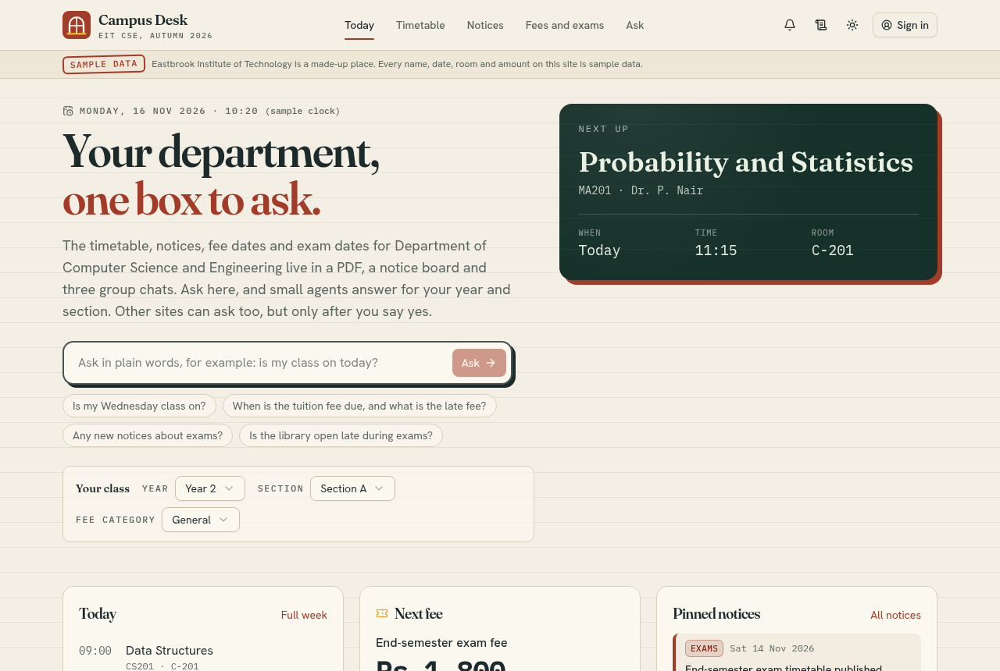
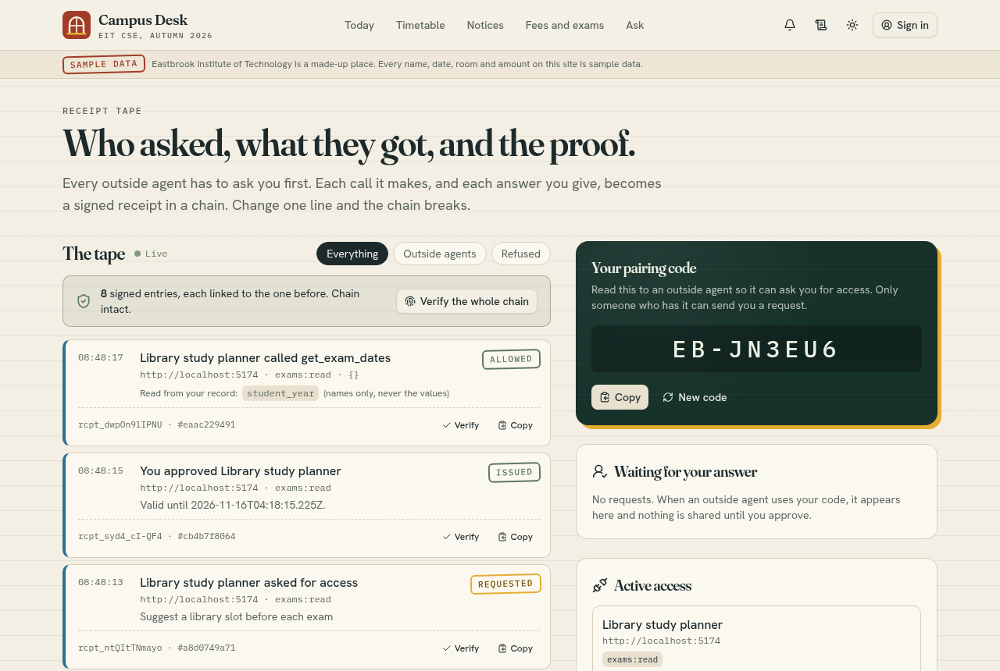
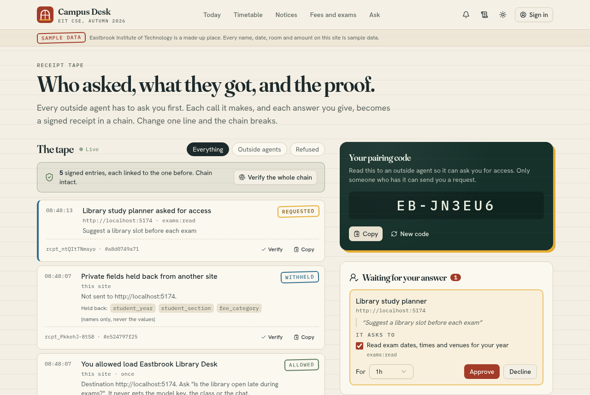
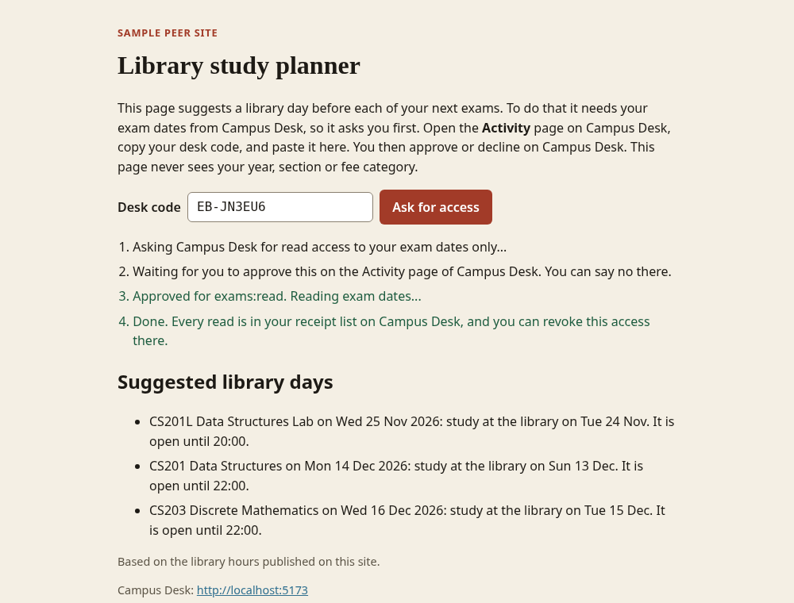
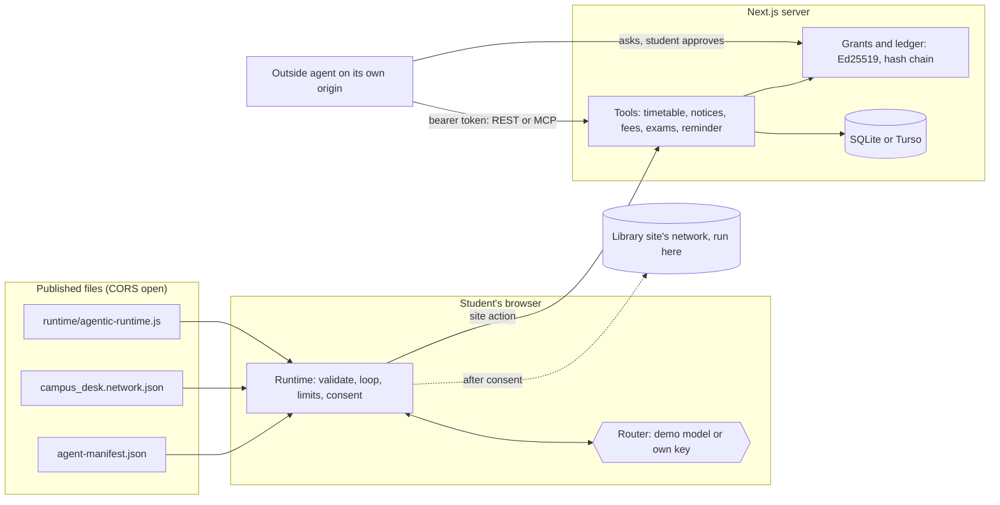

# Campus Desk

A college department website that other agents can use too, and only with the student's yes.

Campus Desk publishes a department's timetable, notices, fee dates and exam dates as an **open agentic website**. A student asks in plain words and small agents answer for their own year and section. Any other agentic site can run the same agents in its own browser. An outside agent that wants the student's live data has to ask first. The student picks what it may read and for how long, and every call it makes becomes a signed receipt the student can verify.

Built for the [Open Agentic Web Challenge](https://cognizant-agenticweb.devpost.com/). It follows the Open Agentic Web minimum specification (MVP Profile 0.2): a public manifest, a data-only agent network, a browser runtime, a model setting with a no-key default and bring-your-own-key, and consent before any other site runs. The grants and receipts are our own optional extension and are labelled that way.

The department in this repo is **made up** (Eastbrook Institute of Technology, fictional). Every name, room, date and amount is sample data and is marked that way on every page.



## Who it is for

**Ananya** is in Year 2, section A. Her class list lives in a PDF, a notice board and three group chats. Before 11 o'clock she wants to know three things: is my class on, when is the tuition fee due, and is there a notice about the exam.

**Ravi** keeps the department's web pages. He wants to publish once, let students ask, and let other approved sites reuse the answers without handing out student data.

Campus Desk gives Ananya one box to ask, and a receipt tape that shows exactly who read what. It gives Ravi a database seeded from four JSON files, a deploy config for a free host, and a checker for his published files.

## What it does

- **Ask in plain words.** "Is my Wednesday class on?" gets the class, the room, and the reason if it is cancelled. "When is the tuition fee due, and what is the late fee?" gets the amount for her fee category and the days left.
- **Four small agents** hand off to each other: front desk, timetable, notices, fees and exams. They are plain data in `campus_desk.network.json`.
- **Six site actions run on the server**, over a SQLite or Turso database. Five read the department data. One saves a reminder, and only after a confirm card shows the exact action.
- **Private by default.** Year, section and fee category live in the student's own record. They are never a tool argument, a prompt, a peer request or a receipt value.
- **Sign in if you want.** A guest session works at once. An account (scrypt-hashed passphrase) keeps reminders across devices, and a guest's reminders move into the account on sign-in. The sample student is `ananya@eastbrook.example` with `chalk-and-brick-2026`.
- **Another site, with consent.** The agent can ask a separate library site. A card names the site and what it will never get. Nothing is contacted until the student agrees.
- **Outside agents ask first** (the standout part, below).
- **Your own key, or no key.** Demo mode runs in the page with no key. Settings take a Gemini key, Otari, or another OpenAI-compatible router. The key stays in the browser and goes only to that router.

| Ask | Confirm a write | Receipts |
|---|---|---|
|  |  |  |

## The standout part: consent receipts

An outside agent cannot read anything until the student says yes.

1. The student opens **Activity** and reads out a pairing code (`EB-XXXXXX`).
2. The agent, on its own origin, posts a request with that code, its name, the scopes it wants and a reason.
3. The request appears on the student's page. They tick the scopes they allow and pick 15 minutes, 1 hour, 24 hours or 7 days.
4. The server signs a grant token (Ed25519): scoped, expiring, tied to the caller's origin. The agent collects it once.
5. Each call is checked (signature, expiry, revocation, origin, scope), answered, and written to the student's **hash-chained, signed ledger**. Refusals are written too.
6. The tape updates live. **Verify the whole chain** walks every link. Any receipt can be checked on the public **/verify** page with the site's public key. Change one character and it fails.
7. **End access** stops the token at once. A write an agent proposes stays pending until the student confirms it on the Reminders page.

The sample library site has a real study planner that does this from another origin: paste the code, approve on Campus Desk, and it suggests library days before each exam from the exam dates alone. The same tools are available over REST and MCP. The protocol is in [docs/protocol.md](docs/protocol.md).

| The request | The library site's page |
|---|---|
|  |  |

## How it works



1. The Ask page loads the **published** runtime file (not a private copy), then the manifest and the network, and validates both before any model call. A bad network, a cycle or a coded tool stops with a visible error.
2. The runtime runs the front agent with the chosen router. The model can only call the agents and actions the network lists.
3. Site actions are server code. The page calls `/api/actions/<name>`. Writes need `confirmed: true` from a confirm card.
4. A peer network is fetched only after the visitor agrees. It is validated, treated as untrusted text and run here with the visitor's router. It gets no key and no private context.
5. The **For agents** page draws the agent graph from the published network and runs the runtime's own validators in the visitor's browser.


### Calling Campus Desk from another site

Two ways, both with consent:

- **Run the agents in your own browser.** Add the network URL to an agent's `tools` and the origin to `allowed_peers`: `"tools": ["https://your-site.example/campus_desk"]`. You get the published facts.
- **Call the live tools.** Use the access flow above. `npx tsx tools/visiting-agent.ts EB-XXXXXX` is a terminal example.

## Run it

Built and tested on Node 24 and Chrome.

```bash
npm install
npm run build:site     # builds the network files, the runtime and the app
npm run build:peer     # builds the sample library site into dist-peer/
npm start              # Campus Desk:   http://localhost:5173
npm run serve:peer     # library site:  http://localhost:5174   (second terminal)
```

For development use `npm run dev`. The first start makes `data/campus.db` and seeds it. Open http://localhost:5173/ask. No key is needed. Try:

- "What is my next class?"
- "Is my Wednesday class on?"
- "When is the tuition fee due, and what is the late fee?"
- "Remind me to pay the tuition fee on 27 Nov" (confirm card)
- "Is the library open late during exams?" (consent card for the second site)

Then open **Activity**, copy the code, open http://localhost:5174/study-planner.html, paste it, and approve.

The sample clock is fixed at **Mon 16 Nov 2026, 10:20** so the answers are the same every time. Set `SITE_CLOCK=real` for the real time.

### Use your own key

On the Ask page choose **AI settings**, pick Gemini, paste a key from Google AI Studio and save. The router is `https://generativelanguage.googleapis.com/v1beta/openai` and the default model is `gemini-2.5-flash` (editable). The key is kept in this browser's local storage, so use a key with a low limit. A Mozilla Otari preset is included. This repo contains no key.

### Check any site

`agentic-check` reads a site's published files and reports against the spec. It works on a folder or a URL.

```bash
npm run check                           # checks public/
npm run check:live                      # checks the running site on :5173
npx tsx tools/agentic-check.ts https://example.org/
npx tsx tools/agentic-check.ts public --json
```

### Publish your own department

1. Replace `data/seed/*.json` (same shape). Delete `data/campus.db` so it reseeds.
2. Set the environment in `.env.example`. A hosted copy uses a free Turso database.
3. Deploy to Vercel or Firebase App Hosting. See [docs/deploy.md](docs/deploy.md).

## Tests

| Command | What it runs | Last result |
|---|---|---|
| `npm run build` | style check (no em dashes, no banned words), type check, 181 tests, `next build`, library site build | passes |
| `npm run e2e` | real Chrome against `next start` (throwaway database) and the library site: every page, the demo beats, confirm and consent cards, own-key settings against a fake router, the whole access hand-off from another origin (request, approve, read, tape, revoke, verify), REST and MCP, sign-in and sign-up, axe-core on ten pages in both themes, phone width, reduced motion | passes, 53 checks |
| `npm run check` | `agentic-check` on `public/` | passes, 14 checks |

The unit tests run on a real database file. They cover all seven interoperability checks from the spec against the real published files, passwords and sessions, the signed ledger (tamper, removal, forged signature), grants (scope, expiry, revoke, wrong origin, forged token, wrong site), and the tools.

## Privacy and safety choices

| Choice | Where it is enforced |
|---|---|
| Private context is deny by default | The front agent names no field in `allow`. Tools read year, section and fee category from the student's record. Receipts list field names only. Tests: `interop.test.ts`, `server.test.ts`, e2e |
| The key goes only to the chosen router | `OpenAICompatClient` sends it only to the router URL. The e2e test records every request |
| Router must be https (or loopback) | `assertSafeRouterUrl` |
| Consent before any other site | `loadPeer` asks first. A redirect to another origin asks again |
| Peers are untrusted text | The system prompt marks peer instructions as untrusted. A peer cannot change the router |
| Writes need a person | A confirm card for the student's own writes. An outside agent's write stays pending until confirmed |
| Grants are narrow | Scoped, expiring, revocable, origin-bound for browsers, rate limited. Token shown once and then deleted from the database |
| Receipts cannot be quietly edited | Hash chain plus Ed25519 signatures, verified in the browser with WebCrypto |
| Passphrases | scrypt with a salt. One error message for a wrong email and a wrong passphrase. Sign-in is rate limited |
| Strict page policy | Nonce-based content security policy, framing blocked, nosniff |
| Fail closed | Depth, agent calls, remote calls and time are limited. Over a limit the call stops with a visible error |

## Honest limits

- **Not deployed yet.** There is no public URL. `docs/deploy.md` has the steps. Two real HTTPS sites calling each other is untested. It has run between two local ports.
- **Demo mode is not a language model.** It is a small rule-based program that understands a fixed set of questions and says so on the page. It drives the real runtime, so the agent calls, consent and receipts are real.
- **Gemini and Otari have not been run against the live services.** The own-key path is tested against a fake router. If Google's endpoint does not allow browser calls from your site, the page shows a message that points to CORS.
- **MCP.** Our server speaks JSON-RPC over HTTP POST with JSON replies and is tested with the runtime's own client. It has not been tried with Claude, Cursor or another real client. WebMCP registration (read actions only) was not tried in a browser with WebMCP.
- **Grants and receipts are an extension.** The minimum profile has no site-to-site action calls. The manifest says so.
- **Without Turso the data does not last on a serverless host.** Vercel's temp folder is wiped on a cold start. Use Turso for judging.
- **Rate limits are per server instance.**
- **The demo account's passphrase is public** by design. Turn it off with `SEED_DEMO_ACCOUNT=0`.
- **Chrome only** has been tested.
- **The reference validator** (nsdeploy) is not part of `npm test`. Re-run it by hand on this build.
- **The runtime is its own code,** written for this entry. It is compatible with the reference format but is not the reference runtime.

## Project layout

```
app/           pages and API routes (Next.js App Router), proxy.ts for the CSP and guest session
components/    shadcn/ui components, the Eastbrook design pieces, the Ask, Activity and Agents screens
lib/           database, store, grants, ledger, crypto, tools (server code)
src/runtime/   the browser runtime: validate, engine, peer loading, model clients, MCP, WebMCP
src/site/      tool catalog, browser action handlers, demo model, shared checks
src/data/      the data types and the functions that answer from them
network/       builders for the agent networks and manifests (Campus Desk and the library peer)
data/seed/     the made-up department's data, loaded into the database on first start
public/        generated manifest and network, links, favicon (the runtime is built in here)
peer/          the library site's published files and the study planner script
tools/         agentic-check (conformance checker) and visiting-agent (terminal client)
scripts/       build, serve, seed, e2e, screenshots, deck, style check
tests/         unit and interop tests
docs/          criteria map, protocol, deploy steps, screenshots, deck
```

## Licence

Apache License 2.0. See `LICENSE` and `NOTICE`.
