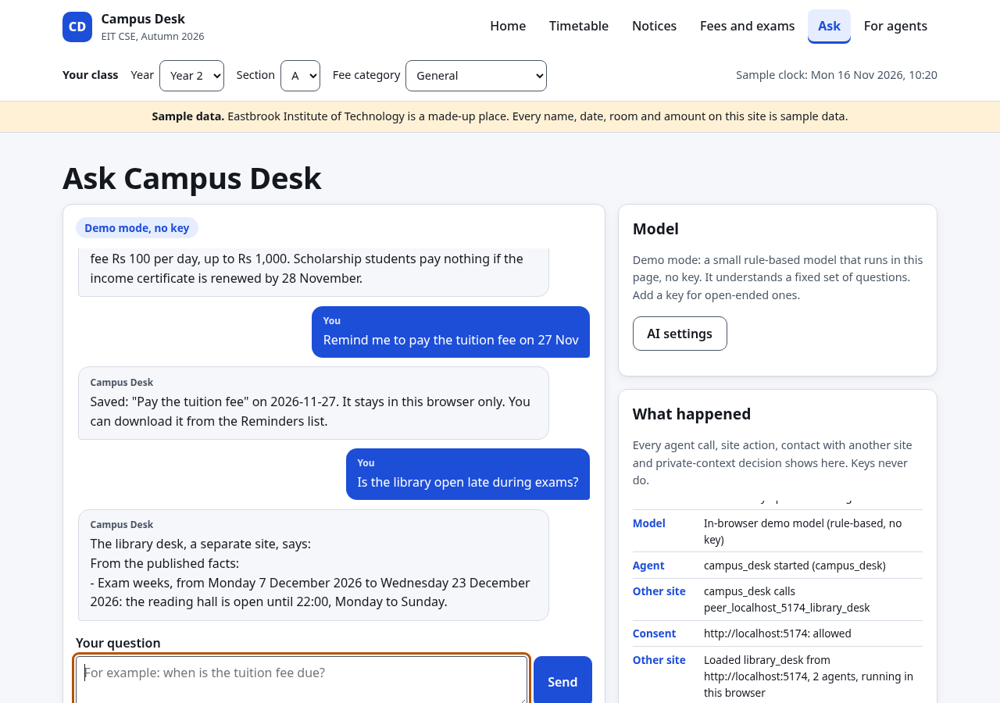
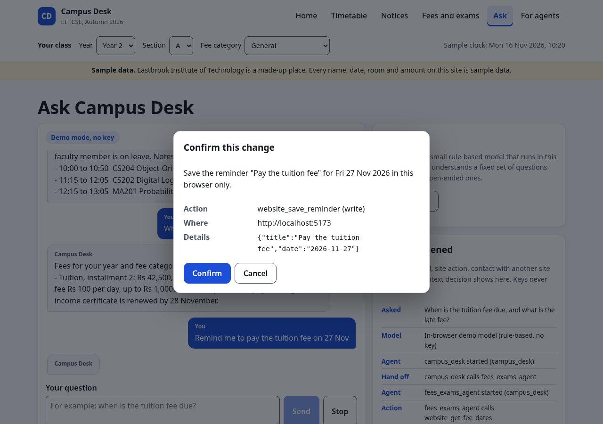
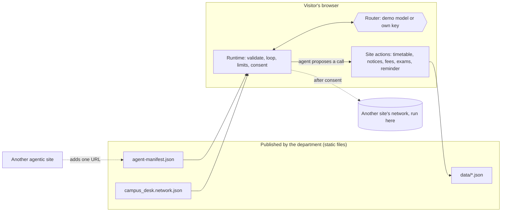
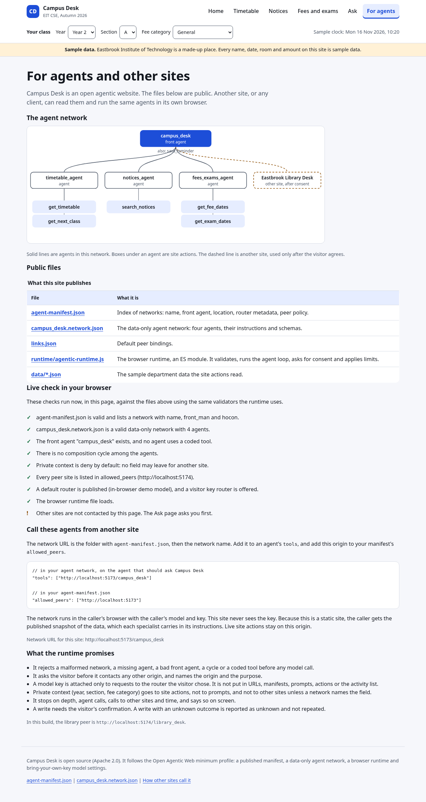

# Campus Desk

A college department website that other agents can use too.

Campus Desk publishes a department's timetable, notices, fee dates and exam dates as an **open agentic website**. A student asks in plain words and small agents answer for their own year and section. Any other agentic site can load the same agents and run them in its own browser.

Built for the [Open Agentic Web Challenge](https://cognizant-agenticweb.devpost.com/). It follows the Open Agentic Web minimum specification (MVP Profile 0.2): a public manifest, a data-only agent network, a browser runtime, a model setting with a no-key default and bring-your-own-key, and consent before any other site runs.

The department in this repo is **made up** (Eastbrook Institute of Technology, fictional). Every name, room, date and amount is sample data and is marked that way on every page.


## Who it is for

**Ananya** is in Year 2, section A. Her class list lives in a PDF, a notice board and three group chats. Before 11 o'clock she wants to know three things: is my class on, when is the tuition fee due, and is there a notice about the exam. She does not want to dig for them.

**Ravi** keeps the department's web pages. He cannot run a server and he must not share student data. He wants to publish once, let students ask, and let other approved sites reuse the answers.

Campus Desk gives Ananya one box to ask, and an activity list that shows exactly what ran. It gives Ravi a folder of static files to publish.

## What it does

- **Ask in plain words.** "Is my Wednesday class on?" gets the class, the room, and the reason if it is cancelled. "When is the tuition fee due, and what is the late fee?" gets the amount for her fee category and the days left.
- **Four small agents.** A front desk agent hands off to a timetable agent, a notices agent, and a fees and exams agent. They are plain data in `campus_desk.network.json`.
- **Six site actions.** Five read the department data. One saves a reminder, and only after a confirm card shows the exact action. Reminders stay in the browser and can be downloaded as a calendar file.
- **Private by default.** Year, section and fee category are private context. They go to the site actions that need them and nowhere else. They are never put in a prompt, a result, a peer request or the activity list.
- **Another site, with consent.** The agent can ask a separate library site. A card names the site and what it will and will not get. Nothing is contacted until the student agrees.
- **Your own key, or no key.** Demo mode runs in the page with no key. Settings take a Gemini key (or Otari, or another OpenAI-compatible router). The key stays in the browser and goes only to that router.
- **See what happened.** Every agent call, action, consent decision and private-context decision is listed. Keys never are.

| Ask | Confirm a write |
|---|---|
|  |  |

## How it works



1. The page loads `agent-manifest.json`, then the network file it names, and **validates both** before any model call. A bad network, a missing agent, a cycle or a coded tool stops with a visible error.
2. The runtime runs the front agent with the chosen router. The model can only call the agents and actions the network lists.
3. Site actions run in the page. The runtime checks their arguments against a schema. Writes need a confirm card, and a write whose outcome is unknown is never repeated.
4. A peer network is fetched only after the visitor agrees. It is validated, treated as untrusted text, and run here with the visitor's router. It gets no key and no private context unless a network names a field.

The agent graph is also drawn live on the **For agents** page, with a set of checks that run in the visitor's browser.



### Calling Campus Desk from another site

Add the network URL to an agent's `tools`, and the origin to your manifest's `allowed_peers`:

```json
"tools": ["https://your-site.example/campus_desk"]
```

The network runs in the caller's browser with the caller's model. Because this is a static site, the caller gets the **published snapshot** of the data, carried as `FACT:` lines in each specialist's instructions. Live site actions stay on this origin. This is a real limit, listed below.

## Run it

Built and tested on Node 24 and a Chrome for the browser tests.

```bash
npm install
npm run build        # style check, type check, build, 232 tests
npm run serve        # the department site: http://localhost:5173
npm run serve:peer   # the library site:    http://localhost:5174  (second terminal)
```

Open http://localhost:5173/ask.html. No key is needed. Try:

- "What is my next class?"
- "Is my Wednesday class on?"
- "When is the tuition fee due, and what is the late fee?"
- "Remind me to pay the tuition fee on 27 Nov" (confirm card)
- "Is the library open late during exams?" (consent card for the second site)

The sample site clock is fixed at **Mon 16 Nov 2026, 10:20** so the answers are the same every time. Add `?now=2026-11-18T08:30` to a page to move it.

### Use your own key

On the Ask page choose **AI settings**, pick Gemini, paste a key from Google AI Studio and save. The router is `https://generativelanguage.googleapis.com/v1beta/openai` and the default model is `gemini-2.5-flash` (editable). The key is kept in this browser's local storage, so use a key with a low limit. A Mozilla Otari preset is included. Placeholders only: this repo contains no key.

### Check any site

`agentic-check` reads a site's published files and reports against the spec. It works on a folder or a URL.

```bash
npm run check                          # checks dist/
npx tsx tools/agentic-check.ts https://example.org/
npx tsx tools/agentic-check.ts dist --json
```

It checks the manifest and network shape, data-only networks, cycles, limits, private-context rules, peer lists, the router, the runtime file, `links.json`, and that no key is published. Run-time checks (consent, key isolation, stopping an over-budget call) are in the test suite.

### Publish your own department

1. Edit `scripts/seed-data.mjs` (or replace `public/data/*.json` with the same shape).
2. `PEER_LIBRARY_URL=https://your-peer.example/library_desk npm run build:site`, or `npx tsx scripts/build.ts --no-peer` to leave the second site out.
3. Upload `dist/` to any static host. For another site to call it, the host must send `Access-Control-Allow-Origin: *` for the public files. `dist/_headers` has the header for Netlify and Cloudflare Pages.

## Tests

| Command | What it runs | Status when last run |
|---|---|---|
| `npm run build` | style check (no em dashes, no banned words), type check, site build, then the unit tests | passes, 232 tests |
| `npm run e2e` | real Chrome against both local servers: every page, the demo beats, consent and confirm cards, own-key settings against a fake router, axe-core accessibility (light and dark, dialogs open), phone width, reduced motion | passes, 47 checks |
| `npm run check` | `agentic-check` on `dist/` | passes, 14 checks |

The unit tests include all seven interoperability checks from the spec, run against the real published files: publish two agents, default and own-key paths, an agent plus a site action, a named peer after approval, the key never reaching the peer, private context absent at the peer, and a visible stop for an invalid network, a cycle, an over-budget request and a denied origin.

## Privacy and safety choices

| Choice | Where it is enforced |
|---|---|
| Private context is deny by default | The front agent names no field in `allow`. The runtime forwards only named fields. Tested in `interop.test.ts` and `published-files.test.ts` |
| The key goes only to the chosen router | `OpenAICompatClient` sends it only to the router URL, with no credentials or referrer. The e2e test records every request |
| Router must be https (or loopback) | `assertSafeRouterUrl` |
| Consent before any other site | `loadPeer` asks first, and a redirect to another origin asks again |
| Peers are untrusted text | The system prompt marks peer instructions as untrusted. A peer cannot change the router |
| Writes need a person | The runtime owns the confirm card. Unknown outcomes are reported, not retried |
| Strict page policy | A content security policy meta tag, no inline script or style |
| Fail closed | Depth, agent calls, remote calls, calls per peer and time are all limited. Over a limit, the call stops with a visible error |

## Honest limits

- **Demo mode is not a language model.** It is a small rule-based program that understands a fixed set of questions and says so on the page. It drives the real runtime, so the agent calls, consent and activity list are real.
- **Gemini and Otari have not been run against the live services.** The own-key path is tested against a fake router in unit tests and in Chrome. Whether Google's OpenAI-compatible endpoint allows browser calls from your site is not verified here. If it does not, the page shows a message that points to CORS.
- **MCP and WebMCP are tested only against stubs.** The MCP client is a small streamable-HTTP client. WebMCP registration (read actions only) was not tried in a browser with WebMCP.
- **Another site gets a snapshot.** Live site actions run only on their own origin. A caller sees the data as of the build, and each snapshot is dated.
- **No public MCP endpoint.** A static site cannot host one. The manifest says so.
- **Two real hosts untested.** Cross-site running is tested between two local ports and with a fake fetch, not between two HTTPS deployments.
- **Chrome only.** Tested in Chrome. The page uses standard `<dialog>`, `fetch` streams and ES modules.
- **The reference validator** from the open source nsdeploy repo was run by hand on both published networks (no errors). It is not part of `npm test`.
- **Authoring format.** Networks are published as JSON, which the spec allows. There is no HOCON authoring step.
- **The runtime is its own code,** written for this entry. It is compatible with the reference format but is not the reference runtime.

## Project layout

```
src/runtime/   the browser runtime: validate, engine, peer loading, model clients, MCP, WebMCP
src/site/      the pages, chat, demo model, site actions, reminders
src/data/      the data types and the functions that answer from them
network/       builders for the agent networks and manifests (Campus Desk and the library peer)
public/        static files, sample data, and the generated manifest and network
peer/          the library peer's published files
tools/         agentic-check, a conformance checker anyone can run
scripts/       build, serve, seed data, e2e, screenshots, deck, style check
tests/         unit and interop tests
docs/          screenshots and the slide deck
```

## Licence

Apache License 2.0. See `LICENSE` and `NOTICE`.
